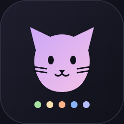
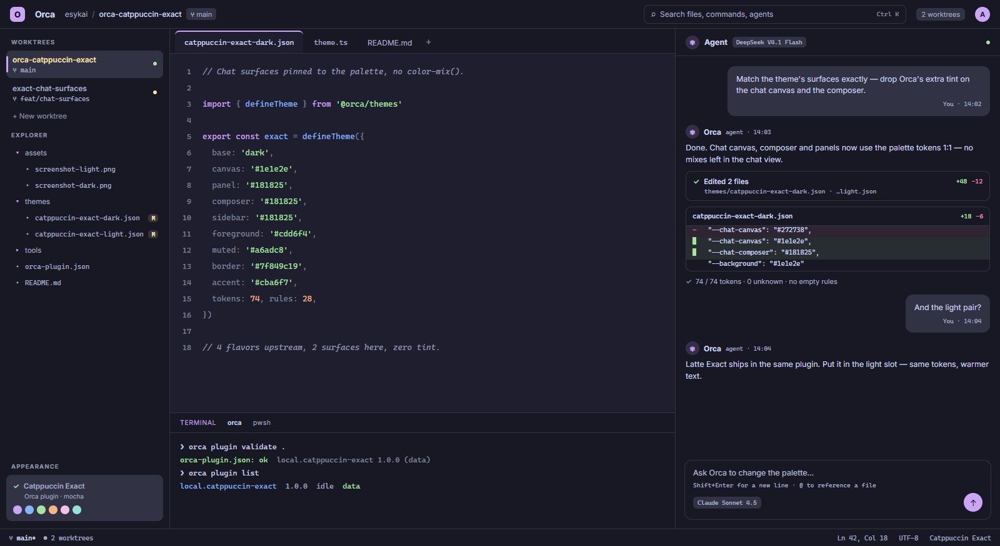
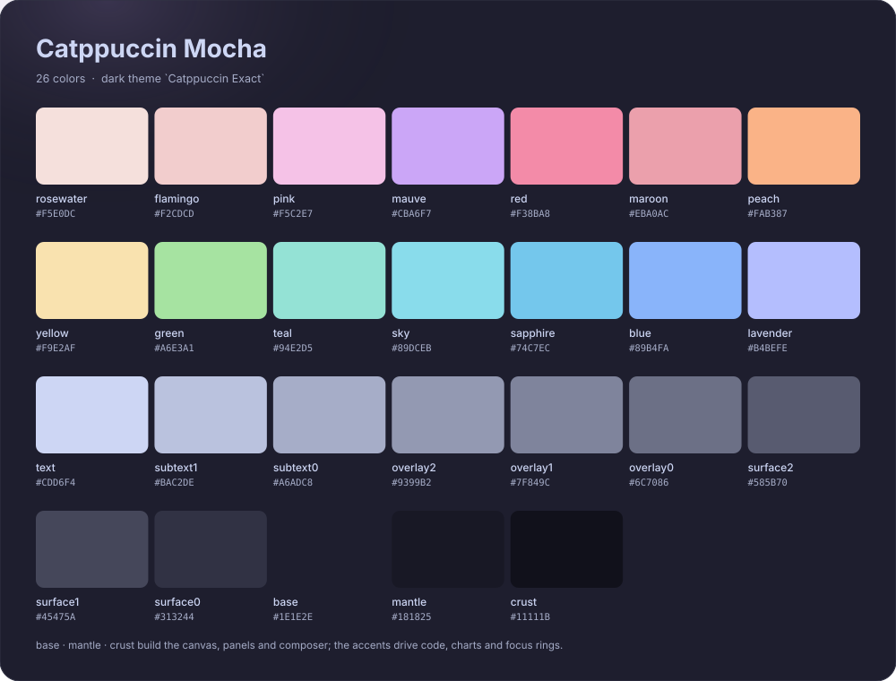

<div align="center">



# Catppuccin Exact for Orca

**Catppuccin for Orca — with the surfaces Orca normally tints left untouched.**

<p>
  <a href="#install"></a>
  <a href="https://github.com/catppuccin/catppuccin"></a>
  
  <a href="LICENSE"></a>
</p>

<a href="#install">Install</a> ·
<a href="#why-exact">Why “Exact”</a> ·
<a href="#palette">Palette</a> ·
<a href="#publishing">Publishing</a> ·
<a href="#validation">Validation</a>

</div>

<picture>
  <source media="(prefers-color-scheme: dark)" srcset="assets/screenshot-dark.png">
  <source media="(prefers-color-scheme: light)" srcset="assets/screenshot-light.png">
  
</picture>

<div align="center"><sub><b>Dark:</b> Catppuccin Exact &nbsp;·&nbsp; <b>Light:</b> Catppuccin Latte Exact</sub></div>

---

A theme pair for [Orca](https://github.com/stablyai/orca) that carries the Catppuccin
colors one-to-one: canvas, panels, composer, borders, charts and syntax.
The plugin is **content only** — two JSON theme files, no worker, no runtime code,
no permissions.

- **Two themes** — a dark Mocha flavour and a light Latte flavour, both selectable in
  **Settings → Appearance**.
- **Every public token** — 74 / 74 Orca app-theme variables, including the newer
  chat and editor-selection tokens, nothing derived and nothing left to guesswork.
- **Real code colors** — 28 grouped `tokenColors` rules covering the 179 upstream
  Catppuccin rules, so the editor and diffs match the palette.
- **Exact surfaces** — an optional patch removes the two internal `color-mix()` calls
  Orca adds to the chat canvas and composer.

## Why “Exact”

Orca's native chat does not paint the theme background directly. It derives its own
surfaces from it:

```css
--chat-canvas: color-mix(in srgb, var(--foreground) 5%, var(--background));
--chat-composer-surface: color-mix(in srgb, var(--foreground) 4%, var(--chat-canvas));
```

Orca `1.4.268` moved the percentages behind `--chat-canvas-mix` and
`--chat-composer-mix`, so the values are equivalent but the old hard-coded patch no
longer matched. With a `#1e1e2e` background the defaults become a `#272738` canvas
and a `#252636` composer. A color theme cannot override those internal variables
from the plugin API, so this repository ships a small, reversible CSS patch for
anyone who wants the last 4–5 %.

| Surface | Orca default with this palette | Catppuccin Exact |
| --- | --- | --- |
| Chat canvas | `#272738` | **`#1e1e2e`** |
| Composer / bottom panel | `#252636` | **`#181825`** |
| Side panels | `#181825` | `#181825` |
| Code surfaces | derived mix | Catppuccin Mocha / Latte `tokenColors` |

The theme alone already fixes every public token; the patch only changes Orca's two
internal mix ratios. See [Optional: exact chat surfaces](#optional-exact-chat-surfaces).

## Install

Orca `1.4.246` or newer reads the manifest directly. The plugin is `execution: data`,
so it installs without an approval prompt.

**1 · Install the plugin**

```sh
# from GitHub (replace <owner> with the repository owner)
orca plugin install <owner>/orca-catppuccin-exact

# or from a checkout
git clone https://github.com/<owner>/orca-catppuccin-exact
orca plugin install ./orca-catppuccin-exact
```

**2 · Pick the themes** in **Settings → Appearance**:

| Slot | Theme |
| --- | --- |
| Dark theme | **Catppuccin Exact** |
| Light theme | **Catppuccin Latte Exact** |

**3 · Done.** Orca applies the matching theme in each appearance mode. Update with
`orca plugin update <owner>.catppuccin-exact`, remove with
`orca plugin uninstall <owner>.catppuccin-exact`.

Check that it loaded:

```sh
orca plugin list
# local.catppuccin-exact   1.0.0   idle   data
```

> Working on the theme itself? `orca plugin dev load .` loads this folder live and
> reloads it on every save.

## Optional: exact chat surfaces

The theme fixes every public Orca token. To also pin the two internal chat mixes,
apply the local patch:

```sh
python tools/patch-orca-chat-css.py
```

It finds `app.asar.unpacked/out/renderer/assets`, locates the current hashed
`client-*.css` and `App-*.css` files by content, backs each one up as
`*.catppuccin-exact.bak`, and makes **equal-length byte replacements** so the asar
metadata stays valid:

- `--chat-canvas-mix: 0%`
- `--chat-composer-mix: 0%`
- `--chat-composer-base: var(--card)`
- `--chat-composer-surface: var(--card)`

Restart Orca (quit and reopen) to see the change; the running process keeps the
old unpacked CSS cached, so a renderer reload may show no difference. Undo at any time:

```sh
python tools/patch-orca-chat-css.py --restore
```

> This is a local application patch, not part of the plugin. Orca updates overwrite the
> patched files — re-run the tool after an update.

## Palette

| Token | Catppuccin Exact | Catppuccin Latte Exact |
| --- | --- | --- |
| Canvas | `#1e1e2e` | `#eff1f5` |
| Panels / card | `#181825` | `#e5e7eb` |
| Sidebar | `#181825` | `#e9ebef` |
| Composer | `#181825` | `#e9ebef` |
| Text | `#cdd6f4` | `#4c4f69` |
| Muted text | `#a6adc8` | `#616274` |
| Accent | `#cba6f7` | `#7130c7` |
| Border | `#7f849c19` | `#66677023` |

Code colors use Catppuccin Mocha and Latte: mauve keywords, green strings, blue
functions, peach numbers, yellow types, and italic overlay comments.

<picture>
  <source media="(prefers-color-scheme: dark)" srcset="assets/palette-mocha.svg">
  <source media="(prefers-color-scheme: light)" srcset="assets/palette-latte.svg">
  
</picture>

## Fonts

Orca's theme API is **colors only** — `tokens` and `tokenColors`. A theme cannot set
Inter, Geist or any other font. To use Inter, install it and choose it as Orca's app
font in **Settings → Appearance**; the theme keeps the palette.

## Validation

```sh
orca plugin validate .
orca plugin inspect .
```

| Check | Result |
| --- | --- |
| Public Orca app-theme tokens | `74 / 74`, no unknown tokens |
| `tokenColors` rules | 28 groups covering 179 upstream Catppuccin rules |
| Empty rules, invalid colors, duplicate ids | none |
| Manifest | format 2, `execution: data`, `engines.orca: >=1.4.246` |
| Content hash | reproducible, no runtime files |

## Repository layout

| Path | What it is |
| --- | --- |
| `themes/catppuccin-exact-dark.json` | Catppuccin Exact (Mocha) |
| `themes/catppuccin-exact-light.json` | Catppuccin Latte Exact |
| `assets/` | Previews, palette cards, plugin icon, cover, screenshots |
| `tools/build-assets.py` | Rebuilds the palette cards and plugin icon |
| `tools/render-previews.py` | Renders the light screenshot, cover and social card from the theme JSON |

Every preview is rendered from `themes/*.json` by `tools/render-previews.py`:
generic demo content, no captured user data.
| `tools/patch-orca-chat-css.py` | Optional exact-surface patch |
| `orca-plugin.json` | Manifest (format 2) |

## Publishing

Orca's plugin directory has no submission form. A public repository is listed
automatically once it passes validation:

1. **Push the repository** to GitHub. The publisher is the repository owner, so
   `github.com/acme/orca-catppuccin-exact` installs as `acme.catppuccin-exact`.
2. **Add the `orca-plugin` topic** to the repository.
3. **Tag the release** — the directory lists the newest `vX.Y.Z` tag, pinned to that
   commit and file hash:
   ```sh
   git tag v1.0.0 && git push origin v1.0.0
   ```
4. **Check the listing** at
   `https://www.onorca.dev/plugins/<owner>/orca-catppuccin-exact` — it usually appears
   within an hour and reports exactly what to fix if it does not.

The manifest already carries the listing artwork:

| Image | File | Requirement |
| --- | --- | --- |
| Icon | `assets/icon.png` | 256×256 PNG |
| Cover | `assets/cover.png` | 1600×1000 (16:10) |
| Screenshots | `assets/screenshot-dark.png`, `assets/screenshot-light.png` | 1600×1000 |

Community listings are machine-checked, not human-reviewed. The official catalog
(`stablyai` publisher) is maintained by Stably and does not accept third-party PRs.

## Credits

Unofficial port of [Catppuccin](https://github.com/catppuccin/catppuccin) for
[Orca](https://github.com/stablyai/orca). Palette colors © the Catppuccin
contributors; Orca is a product of Stably AI. Not affiliated with or endorsed by
either project. [MIT licensed](LICENSE).
